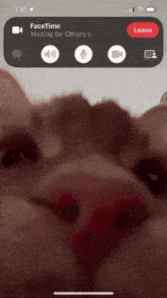
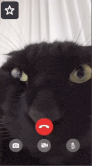

  
  

  

<strong>Português</strong>

 

O **EclairWeb** nasceu de uma pergunta que eu queria responder na prática: **é possível construir um sistema de videochamadas programaticamente, do zero, sem depender de APIs pagas?**

A resposta curta é sim — mas o caminho é mais interessante que a resposta.

 

Existem vários serviços no mercado ([Twilio](https://www.twilio.com/) , [Agora](https://www.agora.io/), [Vonage](https://www.vonage.com.br/)...) que resolvem isso em poucas linhas, mas são pagos por minuto e escondem o funcionamento interno. Eu queria dominar o [protocolo](https://webrtc.org/), não apenas consumir uma caixa-preta.
 
 
 

---

  

Foi aí que eu mergulhei no [**WebRTC**](https://github.com/webrtc) — um protocolo de 2011, padronizado pelo W3C e IETF, que é literalmente a espinha dorsal de toda chamada de vídeo que existe na web hoje (Google Meet, Discord, WhatsApp Web, Whereby).

É um protocolo considerado "antigo" no vocabulário da internet moderna, mas continua sendo a única forma **nativa e gratuita** de fazer mídia peer-to-peer no navegador.

 

---

  

 

| # | Comando | Quando rodar | O que faz |
|:-:|---------|--------------|-----------|
| 1 | `npm install` | Sempre (primeira vez, ou após mudar `package.json`) | Instala o `firebase-tools` e demais dependências do projeto |
| 2 | `npx firebase login` | Uma vez por máquina (só se ainda não estiver logado) | Autentica sua conta Google no Firebase CLI |
| 3 | `npx firebase init emulators` | Uma vez por projeto | Configura os emuladores locais — marque **Auth**, **Firestore** e **Hosting** no wizard |
| 4 | `npm start` | Toda vez que for testar | Sobe os emuladores e serve a aplicação em `http://localhost:5000` |

---

 **Conexões Peer-to-Peer (Mesh)**: Cada participante se conecta diretamente a todos os outros, sem servidor de mídia no meio. Latência mínima e privacidade máxima.
 
 
 **Negociação de Sessão (Offer/Answer)**: Fluxo completo de sinalização via Firestore, com `createOffer`, `createAnswer`, `setLocalDescription` e `setRemoteDescription`.
 
 
 **Troca de ICE Candidates**: Coleta e troca de candidatos em tempo real através de subcoleções no Firestore, permitindo que os navegadores encontrem a melhor rota de rede (STUN).
 
 
 **Mídia Direta no Navegador**: Áudio e vídeo viajam de navegador para navegador usando os codecs nativos (VP8/VP9/Opus), sem intermediários.
 
 
 **Salas Temporárias**: Código alfanumérico de 8 caracteres gerado criptograficamente (`crypto.getRandomValues`), sem necessidade de login.
 
 
 **Criptografia Obrigatória (DTLS-SRTP)**: Todo o tráfego de mídia é criptografado por padrão pelo protocolo, sem configuração extra.
 
 
 **Sem Servidor de Mídia**: Os dados nunca passam por um servidor central; apenas a sinalização (pequenos pacotes JSON) usa o Firestore.

---

   

O EclairWeb é o resultado desse estudo: um projeto **100% gratuito de operar**, que não usa nenhum servidor de mídia, apenas o navegador do usuário, a API `RTCPeerConnection` e o Firestore como sinalizador.

Para os mais interessados, segue aqui alguns links de vídeos e documentações que CERTAMENTE me ajudaram a fazer o projeto tornar real!

[Codelab Oficial do Google](https://codelabs.developers.google.com/codelabs/webrtc-web) |
[Resumo WebRTC Rápido](https://www.youtube.com/watch?v=WmR9IMUD_CY) |
[Sistema de Broadcast WebRTC](https://www.youtube.com/watch?v=GMbdEnK8h3U) |
[Configurar um DataChannel](https://www.youtube.com/watch?v=aboF_ly90vg)

<strong>English</strong>

 

**EclairWeb** started from a question I wanted to answer in practice: **can I build a video call system by writing code, from scratch, without paid APIs?**

The short answer is yes — but the journey is more interesting than the answer.

 

There are many services on the market ([Twilio](https://www.twilio.com/), [Agora](https://www.agora.io/), [Vonage](https://www.vonage.com.br/)...) that solve this in a few lines. But they are paid per minute, and they hide how they work inside. I wanted to understand the [protocol](https://webrtc.org/), not just use a closed box.
 
 
 

---

  

That is when I went deep into [**WebRTC**](https://github.com/webrtc) — a protocol from 2011, made a standard by W3C and IETF. It is the main foundation of almost every video call on the web today (Google Meet, Discord, WhatsApp Web, Whereby).

It is considered "old" in modern internet words, but it is still the only **native and free** way to send media peer-to-peer in the browser.

 

---

  

 

| # | Command | When to run it | What it does |
|:-:|---------|----------------|--------------|
| 1 | `npm install` | Always (first time, or after changing `package.json`) | Installs `firebase-tools` and the other project dependencies |
| 2 | `npx firebase login` | Once per machine (only if you are not logged in yet) | Logs in to your Google account in the Firebase CLI |
| 3 | `npx firebase init emulators` | Once per project | Sets up the local emulators — choose **Auth**, **Firestore**, and **Hosting** in the wizard |
| 4 | `npm start` | Every time you want to test | Starts the emulators and serves the app at `http://localhost:5000` |

---

 **Peer-to-Peer connections (Mesh)**: Each participant connects directly to every other participant. No media server in the middle. Very low delay and strong privacy.
 
 
 **Session negotiation (Offer/Answer)**: Full signaling flow through Firestore, with `createOffer`, `createAnswer`, `setLocalDescription`, and `setRemoteDescription`.
 
 
 **ICE candidate exchange**: Candidates are collected and exchanged in real time through Firestore subcollections. This lets the browsers find the best network route (STUN).
 
 
 **Direct media in the browser**: Audio and video go from browser to browser using native codecs (VP8/VP9/Opus). No middleman.
 
 
 **Temporary rooms**: An 8-character letters-and-numbers room code made with a secure random generator (`crypto.getRandomValues`). No login needed.
 
 
 **Mandatory encryption (DTLS-SRTP)**: The protocol encrypts all media traffic by default. No extra setup.
 
 
 **No media server**: Data never goes through a central server. Only signaling (small JSON packets) uses Firestore.

---

   

EclairWeb is the result of this study: a project that is **100% free to run**. It uses no media server. It uses only the user's browser, the `RTCPeerConnection` API, and Firestore as the signaling service.

If you want to learn more, here are some videos and docs that **definitely** helped me make this project real!

[Official Google Codelab](https://codelabs.developers.google.com/codelabs/webrtc-web) |
[Quick WebRTC Summary](https://www.youtube.com/watch?v=WmR9IMUD_CY) |
[WebRTC Broadcast System](https://www.youtube.com/watch?v=GMbdEnK8h3U) |
[Set up a DataChannel](https://www.youtube.com/watch?v=aboF_ly90vg)

