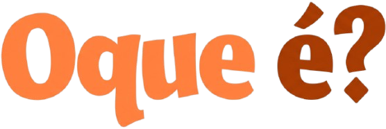
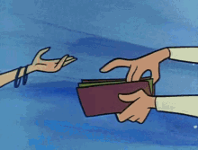
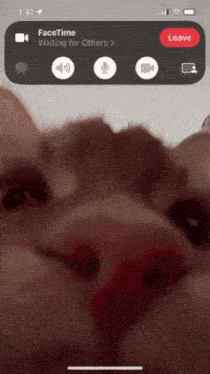
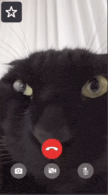

  
  

  

---

O **EclairWeb** nasceu de uma pergunta que eu queria responder na prática: **é possível construir um sistema de videochamadas programaticamente, do zero, sem depender de APIs pagas?**

A resposta curta é sim — mas o caminho é mais interessante que a resposta.

 

Existem vários serviços no mercado ([Twilio](https://www.twilio.com/) , [Agora](https://www.agora.io/), [Vonage](https://www.vonage.com.br/)...) que resolvem isso em poucas linhas, mas são pagos por minuto e escondem o funcionamento interno. Eu queria dominar o [protocolo](https://webrtc.org/), não apenas consumir uma caixa-preta.
 
 
 

---

  

Foi aí que eu mergulhei no [**WebRTC**](https://github.com/webrtc) — um protocolo de 2011, padronizado pelo W3C e IETF, que é literalmente a espinha dorsal de toda chamada de vídeo que existe na web hoje (Google Meet, Discord, WhatsApp Web, Whereby).

É um protocolo considerado "antigo" no vocabulário da internet moderna, mas continua sendo a única forma **nativa e gratuita** de fazer mídia peer-to-peer no navegador.

 

---

  

 

| # | Comando | Quando rodar | O que faz |
|:-:|---------|--------------|-----------|
| 1 | `npm install` | Sempre (primeira vez, ou após mudar `package.json`) | Instala o `firebase-tools` e demais dependências do projeto |
| 2 | `npx firebase login` | Uma vez por máquina (só se ainda não estiver logado) | Autentica sua conta Google no Firebase CLI |
| 3 | `npx firebase init emulators` | Uma vez por projeto | Configura os emuladores locais — marque **Auth**, **Firestore** e **Hosting** no wizard |
| 4 | `npm start` | Toda vez que for testar | Sobe os emuladores e serve a aplicação em `http://localhost:5000` |

---

 **Conexões Peer-to-Peer (Mesh)**: Cada participante se conecta diretamente a todos os outros, sem servidor de mídia no meio. Latência mínima e privacidade máxima.
 
 
 **Negociação de Sessão (Offer/Answer)**: Fluxo completo de sinalização via Firestore, com `createOffer`, `createAnswer`, `setLocalDescription` e `setRemoteDescription`.
 
 
 **Troca de ICE Candidates**: Coleta e troca de candidatos em tempo real através de subcoleções no Firestore, permitindo que os navegadores encontrem a melhor rota de rede (STUN).
 
 
 **Mídia Direta no Navegador**: Áudio e vídeo viajam de navegador para navegador usando os codecs nativos (VP8/VP9/Opus), sem intermediários.
 
 
 **Salas Temporárias**: Código alfanumérico de 8 caracteres gerado criptograficamente (`crypto.getRandomValues`), sem necessidade de login.
 
 
 **Criptografia Obrigatória (DTLS-SRTP)**: Todo o tráfego de mídia é criptografado por padrão pelo protocolo, sem configuração extra.
 
 
 **Sem Servidor de Mídia**: Os dados nunca passam por um servidor central; apenas a sinalização (pequenos pacotes JSON) usa o Firestore.

---

   

O EclairWeb é o resultado desse estudo: um projeto **100% gratuito de operar**, que não usa nenhum servidor de mídia, apenas o navegador do usuário, a API `RTCPeerConnection` e o Firestore como sinalizador.

Para os mais interessados, segue aqui alguns links de vídeos e documentações que CERTAMENTE me ajudaram a fazer o projeto tornar real!

[Codelab Oficial do Google](https://codelabs.developers.google.com/codelabs/webrtc-web) |
[Resumo WebRTC Rápido](https://www.youtube.com/watch?v=WmR9IMUD_CY) |
[Sistema de Broadcast WebRTC](https://www.youtube.com/watch?v=GMbdEnK8h3U) |
[Configurar um DataChannel](https://www.youtube.com/watch?v=aboF_ly90vg)
